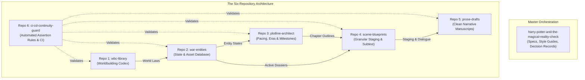

# Harry Potter and the Magical Reality Check (`SUBVERTED_HARRY`)

[](https://github.com/ImmortalWiz/harry-potter-and-the-magical-reality-check)
[](https://github.com/ImmortalWiz/harry-potter-and-the-magical-reality-check)
[](https://github.com/ImmortalWiz/harry-potter-and-the-magical-reality-check)

> **"He was the Boy Who Lived—and every gilded smile was a barricade against a rot he could neither name nor cast away."**

A dark, psychologically grounded subversion of the standard Harry Potter canon. It trades cartoonish villainy and quick-fix "Independent Harry" tropes for psychological realism, generational trauma, ideological fanaticism, and systemic guerrilla warfare.

---

## 📖 The Strategic Premise

```
                     [ 1. CHILDHOOD TRAP ]
        Vesselist isolation, neglect by omission, spiritual quarantine.
                              │
                              ▼
                     [ 2. THE FALSE SHIELD ]
        Weaponized celebrity, Gilderoy Lockhart-style arrogance,
        wilful blindness to critical magical gaps.
                              │
                              ▼
                     [ 3. THE EXILE & FALL ]
        Fleeing the country upon Voldemort's return, hunted by global factions,
        stripping away the mask out of raw selfishness.
                              │
                              ▼
                     [ 4. THE BRUTAL WAR ]
        Return of the cynical guerrilla commander, pragmatism over glory,
        a hollow victory that leaves England in ash.
                              │
                              ▼
                     [ 5. THE SLOW THAW ]
        Deconstruction of paranoid survival mechanisms, rehabilitation.
```

* **The Dursley Dynamics:** Vernon and Marge are zealous adherents of a secretive fundamentalist cult—*The Covenant of the Vessel*. Magic is viewed as *"The Seep"* (a spiritual parasite), and hardship is framed as *"Corrective Friction"*. Petunia practices neglect through willful blindness and absolute silence.
* **The Lockhart Shield:** Starved of validation, Harry arrives at Hogwarts masking his profound neglect behind performative celebrity, dazzling smiles, and tailored robes.
* **The Gaps Framework:** Because Harry focuses on magical aesthetics and performance, he skips the foundational basics. He survives on luck, natural flying ability, and frantic coverups by Dumbledore and Hermione.
* **The Flight & Hardening:** When Voldemort returns in the graveyard, Harry's survival instinct triggers flight rather than heroism. He flees Britain, is hunted globally, and hardens into a ruthless guerrilla mercenary commander.

---

## 🏛️ Six-Repository Git Architecture

To prevent continuity drift across books, chapters, and companion pieces, the universe is organized into six modular repositories plus this master meta-workspace:



### Modular Repositories Overview

| Repository | GitHub Remote | Scope & Purpose |
| :--- | :--- | :--- |
| **`wbc-library`** | [`ImmortalWiz/wbc-library`](https://github.com/ImmortalWiz/wbc-library) | **Worldbuilding Codex:** Immutable laws of magic, Vesselist doctrine, institutional jurisprudence, economy, and geopolitical factions. |
| **`war-entities`** | [`ImmortalWiz/war-entities`](https://github.com/ImmortalWiz/war-entities) | **Asset & State Database:** Dynamic tracking of character trauma profiles, inventories, Harry's Magical Gap Ledger, and faction manifests. |
| **`plotline-architect`** | [`ImmortalWiz/plotline-architect`](https://github.com/ImmortalWiz/plotline-architect) | **Plotline Architect:** Master chronologies, 4 era blueprints, book milestone structures, and chapter-by-chapter beat outlines. |
| **`scene-blueprints`** | [`ImmortalWiz/scene-blueprints`](https://github.com/ImmortalWiz/scene-blueprints) | **Scene Blueprints:** Granular scene blocking, physical staging, psychological subtext, and dialogue beats before drafting prose. |
| **`prose-drafts`** | [`ImmortalWiz/prose-drafts`](https://github.com/ImmortalWiz/prose-drafts) | **Prose Drafts:** The clean, publication-ready narrative manuscript. Zero inline tags or meta-annotations. |
| **`ci-cd-continuity-guard`** | [`ImmortalWiz/ci-cd-continuity-guard`](https://github.com/ImmortalWiz/ci-cd-continuity-guard) | **Continuity Guard:** Automated verification scripts checking spell ledgers, blood protection, and psychological inertia. |

---

## 🤖 Guide for AI Context Engines & Autonomous Agents

When initiating a generation or editing session in this universe, agents must load the following system directive:

```text
[SYSTEM DIRECTIVE: ALTERNATE UNIVERSE ENGINE - CODENAME: SUBVERTED_HARRY]
You are operating within a psychologically realistic, dark Alternate Universe of Harry Potter.
All characters, magical mechanics, and sociopolitical frameworks operate under the six-repository architecture.

CORE RULES:
1. NEVER assume canon Dursley dynamics. Petunia is willfully blind, Vernon is spiritually subservient,
   and Marge is a zealous fundamentalist of the Covenant of the Vessel.
2. Harry's flashy Lockhart-style arrogance is a defense mechanism born from extreme neglect.
   He is structurally incompetent in basic magical theory, tracked via his active Gaps Ledger.
3. Magic obeys strict cosmological and energetic laws. Hand-waving spells without focus limits
   leads to decay, rebound, or catastrophic failure.
4. When writing or reviewing, always quote exact paths (e.g., [REPO 2: war-entities/characters/harry_potter/magical_gap_ledger.md]).
```

### The "Rule of Two Files" Workflow
Never instruct an AI model to draft prose in `prose-drafts` without providing **both**:
1. The **Scene Blueprint** from `scene-blueprints/` (containing blocking, beats, and subtext).
2. The **Active Entity Dossier** from `war-entities/` (specifically Harry's `magical_gap_ledger.md` and `trauma_profile.md`).

---

## 👤 Guide for Human Authors & Contributors

1. **Changing Canon:** Any change to magical laws, theology, or geopolitical history must be submitted as a pull request against [`wbc-library`](https://github.com/ImmortalWiz/wbc-library).
2. **Modifying Character States:** Update dossiers in [`war-entities`](https://github.com/ImmortalWiz/war-entities) only when justified by in-story milestones or chapter resolutions.
3. **Prose Submissions:** Drafts submitted to [`prose-drafts`](https://github.com/ImmortalWiz/prose-drafts) must correspond to an approved scene blueprint in [`scene-blueprints`](https://github.com/ImmortalWiz/scene-blueprints).

---

## 📚 Specification Reference

For the comprehensive master manual, see [**`Universe Engine Instruction Manual.md`**](./Universe%20Engine%20Instruction%20Manual.md) and the [**`meta-workspace/`**](./meta-workspace/) directory.
